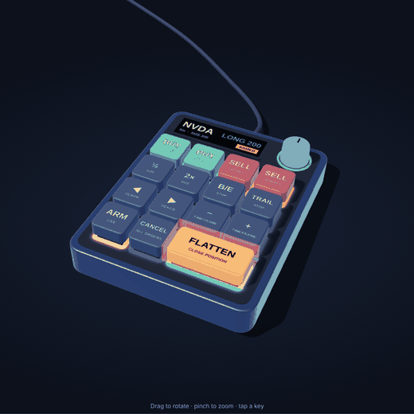
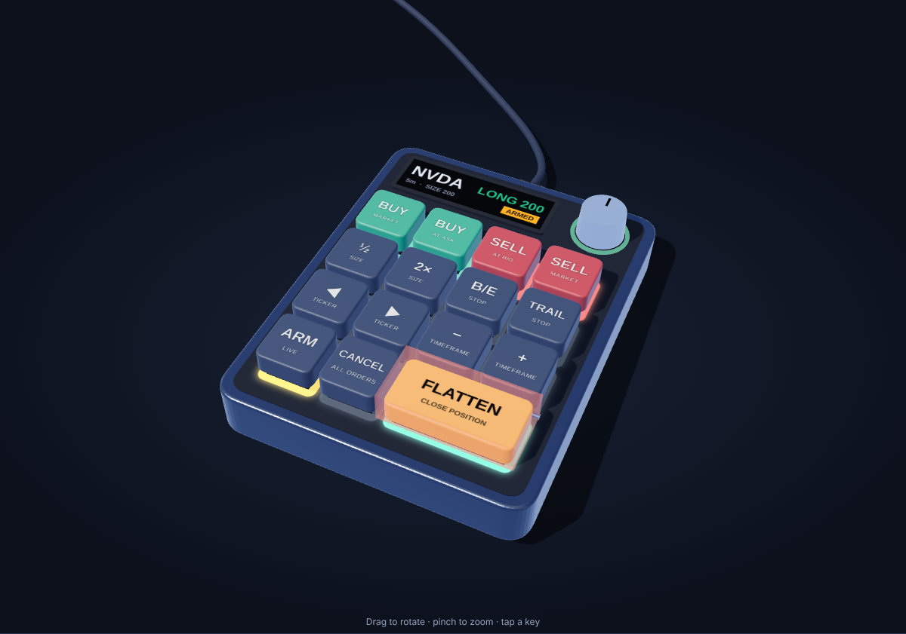
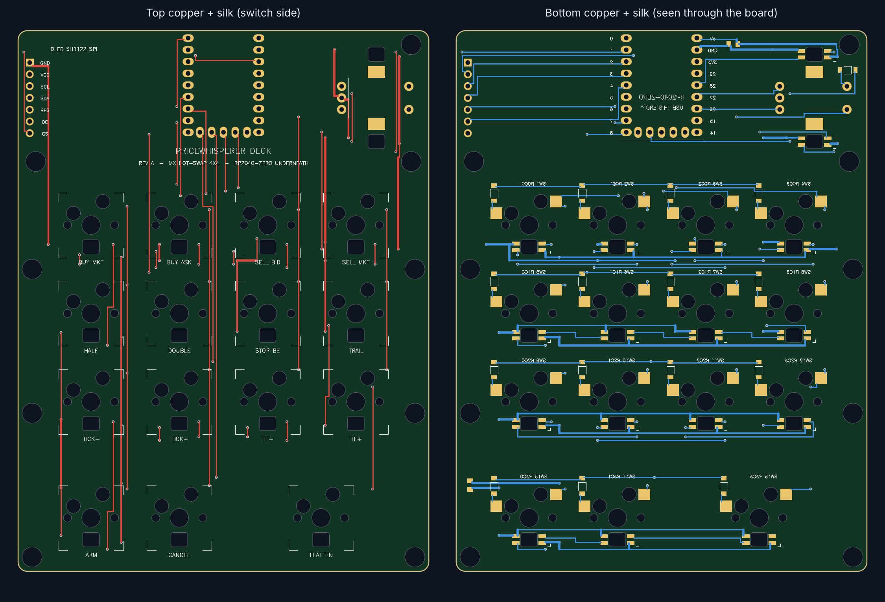

# PriceWhisperer Deck, rev A: case and board files

## 3D concept
The original concept is in [`concept/index.html`](concept/index.html). Open it in a browser to rotate it, tap keys, arm live orders and flip the FLATTEN guard. It loads three.js from a CDN, so it needs a network connection.

The concept is the design intent, not the built geometry. The case and board below differ from it in the ways listed under "What changed from the 3D concept".

## Layout
| Path | Contents |
|---|---|
| `src/` | Python that generates everything: `geom.py` (dimensions), `board.py` (footprints and nets), `route.py`, `fab.py`, `kicad.py`, `stl.py` |
| `gerber/` | Fabrication set: Gerbers, drill files, BOM |
| `stl/` | Printable case parts |
| `kicad/` | The routed board as a KiCad PCB, for KiCad's DRC |
| `concept/` | Interactive 3D concept page |
| `docs/` | Images used in this README |

`./build.sh` regenerates `gerber/`, `stl/`, `kicad/` and the previews from `src/` (`pip install -r requirements.txt` first). The output is deterministic: a rebuild reproduces the Gerbers byte for byte. Change a dimension in `src/geom.py` and both the case and the board follow.

Generated 2026-11-25. Nothing here has been printed, fabricated or powered. Treat it as a first prototype.

## What changed from the 3D concept
- Bottom row (ARM, CANCEL, FLATTEN) sits 6 mm below the other rows. The gap carries the guard hinge.
- FLATTEN is a 2u key shifted 2 mm right so the guard clears CANCEL.
- The display and dial sit on a raised deck, 5.5 mm above the switch plate.
- Outside size 94.4 x 122.4 mm, 20.6 mm tall at the deck, flat-bottomed. The optional rear riser tilts it about 4 degrees.

## Parts list
Links were found by web search on 2026-11-25 and not opened one by one. Check stock, price and shipping before ordering. Refs match `gerber/pw-deck-BOM.csv`.

### Electronics
| Qty | Part | Refs | Where to buy |
|---|---|---|---|
| 1 | Waveshare RP2040-Zero (no headers) | U1 | [Waveshare](https://waveshare.com/rp2040-zero.htm) |
| 15 | Kailh MX hot-swap socket, CPG151101S11 | SW1-SW15 | [KBDfans](https://kbdfans.com/collections/all/products/mechanical-keyboard-switches-kailh-pcb-socket), [Keyboardio, pack of 25](https://shop.keyboard.io/products/kailh-hotswap-sockets-for-mx-style-keyswitches-x-25), [Elecrow](https://www.elecrow.com/kailh-pcb-socket-sip-socket-hot-swappable-hot-plug-cpg151101s11-for-mechanical-keyboard.html) |
| 17 (buy 20) | SK6812MINI-E reverse-mount RGB LED, LCSC C5149201, sold in fives | LED1-LED15, LEDR1, LEDR2 | [LCSC](https://www.lcsc.com/product-detail/C5149201.html) |
| 16 | 1N4148W diode, SOD-123, LCSC C81598 | D1-D16 | [LCSC](https://www.lcsc.com/product-detail/C81598.html) |
| 2 (min 20) | 10 uF 25 V X5R capacitor, 0805, Samsung CL21A106KAYNNNE, LCSC C15850 | C1, C2 | [LCSC](https://www.lcsc.com/product-detail/C15850.html) |
| 1 | Alps EC11E15244G1 encoder: push switch, 30 detents, 6 mm D-shaft, 20 mm | ENC1 | [Octopart (all distributors)](https://octopart.com/part/alps/EC11E15244G1), [RS](https://ie.rs-online.com/web/p/mechanical-rotary-encoders/7295589), [Avnet](https://www.avnet.com/americas/product/alps-alpine/ec11e15244g1/evolve-169179) |
| 1 | 2.08 in 256x64 OLED module, SH1122, 7-pin SPI, 70.5 x 22.5 mm board | wired to J1 | [Open Electronics](https://oe2.open-electronics.org/?p=42977) |
| 1 strip | 2.54 mm 1x40 pin header, LCSC C2337: cut off 7 pins, or use 7 short wires | J1 | [LCSC](https://www.lcsc.com/product-detail/C2337.html) |
| 5 (fab minimum) | The PCB: 2 layers, 1.6 mm, upload `gerber/` | | [JLCPCB](https://jlcpcb.com/features/pcb-prototype), [PCBWay](https://www.pcbway.com/) |

### Mechanical
| Qty | Part | Where to buy |
|---|---|---|
| 15 (2 packs of 10) | MX-style switches, 3-pin or 5-pin, with an LED slot | [Gateron KS-9, 10 per pack (Apos)](https://apos.audio/collections/all/products/gateron-switches), [Gateron Blue, sold in tens (Mechboards)](https://www.mechboards.co.uk/products/gateron-blue), [price comparison (kbd.news)](https://kbd.news/switch/MX) |
| 14 (2 packs of 10) | 1u keycaps. Relegendable caps take a printed paper legend under a clear cover, which suits BUY, SELL, ARM and the rest | [Adafruit relegendable, 10 pack](https://www.adafruit.com/products/5039), [black relegendable DSA, set of 10 (MechanicalKeyboards)](https://mechanicalkeyboards.com/products/mk-1x1-dsa-relegendable-black-with-clear-top-set-of-10), [blank DSA singles (Signature Plastics)](https://spkeyboards.com/products/sp-dsa-1-space) |
| 1 | 2u keycap for FLATTEN, DSA profile, standard stabiliser mounts | [DSA 2u single (Signature Plastics)](https://spkeyboards.com/products/sp-dsa-2-space) |
| 1 | 2u plate-mount stabiliser, Cherry style | [KBDfans (sold as a set)](https://kbdfans.com/products/cherry-plate-mounted-stablizers) |
| 8 | M2 x 8 self-tapping screws, pan head | [Elecrow, bag of 200](https://elecrow.com/m2-screw-8mm.html) |
| 4 | Stick-on feet, 3M Bumpon SJ5003, 11.2 mm x 5 mm | [Buerklin, from 20](https://www.buerklin.com/en/self-adhesive-housing-bumper/p/20h175), [RS, bag of 56](https://uk.rs-online.com/web/p/anti-slip-pads/0236464) |
| 1 strip | Polyimide (Kapton) tape, 10 mm, under the RP2040-Zero | [Adafruit](https://www.adafruit.com/products/3057), [Olimex via DigiKey](https://www.digikey.be/en/products/detail/olimex-ltd/KAPTON-TAPE10MM/19204468) |
| 1 | USB-C to USB-C data cable, 1 m | [Pimoroni](https://shop.pimoroni.com/products/usb-c-to-usb-c-cable-1m-black) |
| about 75 g | 1.75 mm filament for the case, e.g. Prusament PLA Galaxy Black. A 42 mm offcut is the guard hinge pin | [Prusa](https://shop.prusa3d.com/prusament/711-prusament-pla-prusa-galaxy-black-1kg.html), [Galaxus](https://www.galaxus.de/en/s1/product/prusa-prusament-pla-pla-175-mm-1000-g-black-3d-printer-filament-23959778) |
| a few g | Clear filament for `dial_disc`, e.g. Prusament PETG Clear | [Prusa](https://prusa3d.com/product/prusament-petg-clear-1kg) |

Notes:
- The OLED must be the 70.5 x 22.5 mm board. The 72.5 x 27.4 mm breakout sold elsewhere does not fit the deck pocket.
- Octopart lists a last-time-buy date for the EC11E15244G1, so stock may thin out. Any EC11 with a push switch, a 6 mm D-shaft and 20 mm length fits the footprint and the knob.
- A plate-mount stabiliser is needed, not PCB-mount or screw-in: the board has no stabiliser holes.
- Relegendable 2u caps are rare, so FLATTEN gets a plain 2u cap. Signature Plastics sells singles from over-runs, so colours and stock vary.
- Some Prusa pages mark Galaxy Black PLA as discontinued in the non-NFC spool. Any 1.75 mm PLA or PETG works.
- The foot recesses in `bottom_shell` are 11.6 mm across to take the SJ5003.

## Printed parts (already in print orientation)
| File | Size mm | Volume cm3 |
|---|---|---|
| stl/pw-deck-bottom_shell.stl | 94.4 x 122.4 x 20.6 | 44.7 |
| stl/pw-deck-switch_plate.stl | 89.1 x 86.0 x 25.7 | 7.8 |
| stl/pw-deck-deck.stl | 89.1 x 32.2 x 10.2 | 5.0 |
| stl/pw-deck-flatten_guard.stl | 40.7 x 25.9 x 25.5 | 4.4 |
| stl/pw-deck-dial_disc.stl | 23.0 x 23.0 x 3.0 | 1.0 |
| stl/pw-deck-dial_knob.stl | 15.0 x 15.0 x 14.0 | 2.1 |
| stl/pw-deck-rear_riser_optional.stl | 80.0 x 14.0 x 8.0 | 8.4 |

- 0.4 mm nozzle, 0.2 mm layers. Only the bottom shell's USB opening bridges; no supports needed.
- Print dial_disc in clear or natural filament; it is the light ring under the knob.
- Guard hinge pin: a 42 mm length of 1.75 mm filament through the 2.1 mm holes.
- Screws: 8 x M2 x 8 self-tapping (5 through the plate, 3 through the deck) into 1.7 mm pilot holes.
- The switch plate is 1.5 mm with 14.1 mm cutouts. If switches are loose or tight, scale the cutouts, not the plate.
- Stack: floor 2.0, 6.5 gap, PCB 1.6, plate top 5.0 above the PCB, deck top 10.5 above the PCB.

## Board
- 2 layers, 88.6 x 116.6 mm, 1.6 mm. Track 0.30 mm (supply up to 0.60), clearance 0.20, vias 0.6/0.3 tented.
- Gerber X2 layers plus two Excellon files (PTH has two G85 slots for the encoder lugs; tell the fab if they ask).
- 17 LED windows and the outline are on Edge_Cuts.
- Everything except the encoder and wire header solders to the BOTTOM: hot-swap sockets, diodes, LEDs, 2 capacitors, controller.
- RP2040-Zero is soldered flat on the bottom, component side facing down, USB at the back edge. Put Kapton tape under it: the module has bare pads on its underside.
- Flash the module (or hold BOOT) before closing the case; its buttons face the floor.

### Controller pins
| RP2040-Zero pin | Net |
|---|---|
| GP0 | OLED_RES |
| GP1 | OLED_CS |
| GP2 | OLED_SCK |
| GP3 | OLED_MOSI |
| GP4 | OLED_DC |
| GP5 | COL0 |
| GP6 | COL1 |
| GP7 | ROW0 |
| GP8 | ROW1 |
| GP9 | ROW2 |
| GP10 | ROW3 |
| GP11 | COL2 |
| GP12 | COL3 |
| GP26 | ENC_B |
| GP27 | ENC_A |
| GP28 | LD0 |

GP13, GP14, GP15 and GP29 are free.

### Matrix (diodes: column to row, COL2ROW in QMK)
| | C0 | C1 | C2 | C3 |
|---|---|---|---|---|
| R0 | BUY MKT | BUY ASK | SELL BID | SELL MKT |
| R1 | HALF | DOUBLE | STOP BE | TRAIL |
| R2 | TICK- | TICK+ | TF- | TF+ |
| R3 | ARM | CANCEL | dial push | FLATTEN |

### LED chain (SK6812MINI-E, data from GP28)
LEDR1 > LEDR2 > LED4 > LED3 > LED2 > LED1 > LED5 > LED6 > LED7 > LED8 > LED12 > LED11 > LED10 > LED9 > LED13 > LED14 > LED15

LEDR1/LEDR2 are the dial ring. LED n sits under SW n.

### Display
2.08 in 256x64 SH1122 SPI module (70.5 x 22.5 mm board). It sticks to the underside of the deck and is wired to J1 (GND, VCC 3V3, SCL, SDA, RES, DC, CS, labelled on the board).

## Checks that were run
- Board: every net connected, no copper closer than 0.20 mm to another net, hole and edge clearances, all Gerbers parsed by a second library.
- Case: every part watertight; no overlap between shell, PCB, plate, deck, dial parts and guard, with the guard swept from closed to open.

## Check before you spend money
1. Display: the deck window assumes the glass is centred vertically on the module and sits 1 mm from the module's right-hand end. Measure yours; only the deck needs reprinting if it differs.
2. SK6812MINI-E pin order (1 VDD, 2 DOUT, 3 GND, 4 DIN) matches the open-source kbd footprint and a second public component listing. Still worth a glance at the datasheet for the exact LEDs you buy.
3. Stabiliser cutouts for FLATTEN use the common Cherry plate-mount dimensions from memory. Test-fit on a scrap print.
4. LEDs run from USB 5 V with 3.3 V data, which usually works but is outside the SK6812 spec. Cap brightness in firmware: 17 LEDs at full white exceeds 500 mA.
5. There is no schematic or KiCad project behind these Gerbers. The board was placed and routed by script, so run it through your fab's DFM viewer before ordering.
6. The guard clears keycaps up to about 20 mm above the plate (Cherry, OEM, DSA). SA profile is too tall.
